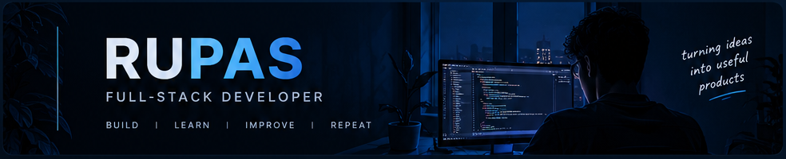

<!-- ==================== HEADER ==================== -->

<div align="center">



<br/>

<a href="https://github.com/Rupas01">
  
</a>

<p>
  <a href="https://github.com/Rupas01">
    
  </a>
  <a href="YOUR_LINKEDIN_URL">
    
  </a>
  <a href="YOUR_PORTFOLIO_URL">
    
  </a>
</p>

</div>

---

<!-- ==================== ABOUT ME ==================== -->

## 👨‍💻 About Me

<table>
<tr>
<td width="60%" valign="top">

### Hey there! 👋

I'm a Computer Science graduate interested in building useful software, modern web experiences, and mobile applications.

- 🎓 B.Tech in CSE (AI & ML)
- 💻 Interested in full-stack development
- ⚙️ Building applications with React and Node.js
- 🗄️ Working with SQL and NoSQL databases
- 🌱 Continuously learning and improving
- 🎯 Focused on writing clean, maintainable code

</td>
<td width="40%" valign="top">

### `developer.js`

```javascript
const rupas = {
  role: "Full-Stack Developer",
  interests: [
    "Web Development",
    "Mobile Apps",
    "Backend Systems",
    "UI/UX"
  ],
  currentlyLearning: [
    "DSA",
    "System Design"
  ],
  mindset: "Build. Learn. Improve."
};

console.log("Let's build something!");
```

</td>
</tr>
</table>

---

<!-- ==================== TECH STACK ==================== -->

## 🛠️ Tech Stack

<p align="center">
  <b>Languages</b>
  <br/><br/>
  
</p>

<p align="center">
  <b>Frontend & Mobile</b>
  <br/><br/>
  
</p>

<p align="center">
  <b>Backend & Databases</b>
  <br/><br/>
  
</p>

<p align="center">
  <b>Tools & Platforms</b>
  <br/><br/>
  
</p>

---

<!-- ==================== FEATURED PROJECTS ==================== -->

## 🚀 Featured Projects

<table>
<tr>
<td width="50%" valign="top">

### 📚 EduBridge

A cross-platform social learning application inspired by online learning platforms and communities.

**Highlights**
- JWT-based authentication
- User profile management
- Media uploads using Cloudinary
- MongoDB Atlas integration

**Built with**

`React Native` `Node.js` `MongoDB`

<a href="https://github.com/Rupas01/EduBridge">
  
</a>

</td>
<td width="50%" valign="top">

### 🎨 Prem Studios Portfolio

A modern portfolio website for a creative editing and motion-graphics business.

**Highlights**
- Responsive layouts
- Modern visual presentation
- Reusable frontend components
- Animated user experiences

**Built with**

`React` `Tailwind CSS` `Vite`

<a href="https://github.com/Rupas01/portfolio-PremStudios">
  
</a>

</td>
</tr>
<tr>
<td width="50%" valign="top">

### 🧠 Quizzer

An interactive quiz management system designed to make quizzes easier to create and participate in.

**Highlights**
- Quiz management
- Interactive quiz experience
- Database-backed application

**Built with**

`JavaScript` `Node.js` `MySQL`

<a href="https://github.com/Rupas01/quizzer">
  
</a>

</td>
<td width="50%" valign="top">

### 🏥 Medical Supply Management

A web-based system for managing medical supplies and inventory workflows.

**Highlights**
- Role-based access
- Inventory management
- Customer and supplier workflows

**Built with**

`Node.js` `Express.js` `MySQL`

<a href="https://github.com/Rupas01/medical-supply-management-system">
  
</a>

</td>
</tr>
</table>

---

<!-- ==================== GITHUB STATISTICS ==================== -->

## 📊 GitHub Statistics

<div align="center">

<a href="https://github.com/Rupas01">
  
</a>

<a href="https://github.com/Rupas01">
  
</a>

<br/><br/>


</div>

---

<!-- ==================== CONTRIBUTION GRAPH ==================== -->

## 📈 Contribution Activity

<div align="center">


</div>

---

<!-- ==================== FOOTER ==================== -->

<div align="center">

### 💡 My Developer Philosophy

<i>Building, learning, and shipping — one project at a time.</i>

<br/><br/>


</div>
